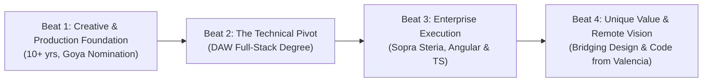

# 💻 English Lesson 03: Full-Stack Tech Interview Mastery, Senior Storytelling & Spoken Fluency
# Lección de Inglés 03: Dominio de Entrevistas Técnicas Full-Stack, Storytelling Senior y Fluidez Verbal

**Target Learner / Estudiante:** Barbara — Full-Stack Web Developer (Valencia, Spain 🇪🇸), former Artistic Director & Goya-nominated film coordinator transitioning into international remote tech roles.  
**Tutor / Instructor:** Louie (Lewis O.) — Former executive recruitment consultant & hiring director.  
**Level / Nivel:** High B2 – C1 (Advanced Professional & Technical English).  
**Duration / Duración:** 60 minutes (Thursday, October 29, 2026 at 9:00 AM with +30m peace-of-mind buffer).  
**Building On / Continuación de:** 
- [Lesson 01 Portal (`index.html`)](./index.html) (October 27, 2026: Career transition, Sopra Steria internship, Angular & TypeScript, Brighton Pier, Valencia life).
- [Lesson 02 Portal (`lesson-02.html`)](./lesson-02.html) (October 28, 2026: Cozy room-unpacking game, spatial prepositions, household objects & natural fluency).  
**Interactive Web Companion:** [Lesson 03 Interactive Lab (`lesson-03.html`)](./lesson-03.html).

---

## 🎯 Lesson 03 Core Objectives

In Lesson 01 (`51:56`), Barbara shared:
> *"In the past I always found jobs through word of mouth ('Do you want to come work with me?'), so I've never done a formal corporate interview where they ask, 'Where do you see yourself in five years?' ... I know the meaning, I just need the words to come quickly to my mouth."*

Today's lesson delivers:
1. **Zero-Latency Fluency:** Eliminating hesitations and pauses when retrieving technical terminology in English.
2. **The 90-Second Hybrid Pitch:** Framing 10+ years in artistic direction, production logistics, and a Spanish Academy Award (Goya) nomination as senior project maturity, paired with full-stack code.
3. **The STAR Technical Storytelling Method:** Communicating real Angular and TypeScript achievements from Sopra Steria with structured clarity.
4. **The 5-Year Vision Question:** Constructing an authentic, grounded response that highlights team loyalty, craft mastery, and remote stability in Valencia.

---

## 💡 Tutor Strategy & Executive Recruitment Playbook (For Louie)

> [!NOTE]
> ### 1. Framing Barbara's "Unfair Advantage"
> Most junior developers entering the market in 2026 are indistinguishable: they know syntax but lack business communication, freeze under deadlines, and cannot talk to design teams. Barbara has **10+ years managing production budgets, scheduling complex deliverables, and shipping a Goya-nominated stop-motion film**. That is not "unrelated background"—that is **executive maturity**. Our goal is to train her to present this background with proud, effortless conviction.

> [!TIP]
> ### 2. The "Pride Comes Before a Fall" Balance (Louie's Hilton Recruitment Insight)
> In Lesson 01 (`54:01`), Louie noted that candidates fail when they carry baggage or arrogantly declare *"At my old company we did it this way."* Barbara is naturally modest and curious. We guide her to strike the sweet spot: eager to absorb team architecture and conventions, while offering the disciplined execution of a seasoned producer.

> [!IMPORTANT]
> ### 3. Dispelling the "AI Junior Market" Uncertainty
> Barbara mentioned feeling *"full of uncertainty with my career change"* due to recent AI shifts. Engineering managers are currently flooded with low-quality, AI-generated spaghetti pull requests. Demonstrating **strict TypeScript type discipline**, strong component encapsulation, and thoughtful architectural reasoning proves she is the kind of engineer AI tools *cannot* replace.

---

## ⚡ Part 1: Fast Spoken Fluency Gym & Hesitation Killers (10 mins)

### A. Rapid-Fire Recall (Zero-Hesitation Target)
Pick 4–5 words from the list below. Barbara has 20 seconds to explain the term or use it in a work context without saying *"um / err"*:

| Term | IPA & Part of Speech | Spanish Equivalent | Operational Tech Context |
| :--- | :--- | :--- | :--- |
| **Trade-off** | `/ˈtreɪd.ɒf/` *(n)* | *Compromiso técnico / concesión* | *"Our main trade-off was between delivery speed and strict TypeScript type coverage."* |
| **Edge case** | `/ˈedʒ ˌkeɪs/` *(n)* | *Caso límite / atípico* | *"We wrote unit tests to ensure empty arrays were handled gracefully as edge cases."* |
| **Bottleneck** | `/ˈbɒt.əl.nek/` *(n)* | *Cuello de botella* | *"The unindexed database query was our primary performance bottleneck."* |
| **Cross-functional** | `/ˌkrɒsˈfʌŋk.ʃən.əl/` *(adj)* | *Multidisciplinar* | *"I thrive in cross-functional squads where design meets engineering."* |
| **Return type** | `/rɪˈtɜːn taɪp/` *(n)* | *Tipo de retorno* | *"I always declare explicit return types after the colon in TypeScript."* |
| **Refactor** | `/ˌriːˈfæk.tər/` *(v/n)* | *Refactorizar código* | *"I refactored a monolithic component into three reusable sub-components."* |
| **State management** | `/steɪt ˈmæn.ɪdʒ.mənt/` *(n)* | *Gestión del estado* | *"Clean state management prevents unpredictable UI re-renders."* |
| **Boilerplate** | `/ˈbɔɪ.lə.pleɪt/` *(n)* | *Código repetitivo / plantilla* | *"Angular schematics handle the boilerplate so we can focus on business logic."* |

### B. The 5 Hesitation Killers (Spoken Buffers)
Coach Barbara to substitute pauses with these natural native phrases:
- *"That's a very fair question—at a high level..."*
- *"The core trade-off we faced was..."*
- *"To put that into practical perspective..."*
- *"In other words, the bottleneck wasn't the API, but..."*
- *"If I zoom in on the technical implementation..."*

---

## 🎤 Part 2: The 90-Second Hybrid Pitch Studio (15 mins)

### The 4-Beat Story Arc
When the interviewer says: *"Tell me about yourself and your journey into software engineering."*

### Complete Model Script (Spoken in ~1m 25s / ~180 words)
> *"I'm a **Full-Stack Web Developer** with a unique background: before transitioning into software engineering, I spent over a decade in **artistic direction and multimedia design**, coordinating budgets, creative teams, and production logistics for major events and even an **animated short film nominated for the Spanish Academy Awards (Goya)**.*
>
> *Because I love building systems from the ground up, I completed Spain's intensive two-year **Advanced Vocational Degree in Web Application Development (DAW)**, focusing on modern web standards, databases, and JavaScript architectures.*
>
> *Most recently, during my internship at **Sopra Steria**, I built client-facing features using **Angular and TypeScript**. Working within strict enterprise conventions, I focused on component lifecycle management, reactive data streams, and robust return-type safety.*
>
> *What I bring to your team is not just clean code, but the **cross-functional maturity** to bridge design and engineering seamlessly. I'm based in Valencia, and I'm looking for a remote full-stack role where I can invest deeply in team growth and help build scalable, user-centric products."*

---

## 🛠️ Part 3: Technical Storytelling Lab — The STAR Method (15 mins)

Teach the **STAR** formula for answering technical behavioral questions:
- **S (Situation):** Set the context and architecture in 20 seconds.
- **T (Task):** State the problem, requirement, or bug in 20 seconds.
- **A (Action):** The specific code, tools, and decisions YOU made in 30 seconds.
- **R (Result):** The measurable improvement or business outcome in 20 seconds.

### Case Study A: Taming Nested APIs with TypeScript Type Safety
- **Situation:** *"At Sopra Steria, our Angular frontend consumed client endpoints with inconsistent nested objects, causing intermittent `undefined` crashes in development."*
- **Task:** *"I was tasked with refactoring our service layer to guarantee strict type contracts across the component tree."*
- **Action:** *"I defined explicit TypeScript interfaces with strict optional flags, enforced generic return types on our HTTP client calls, and mapped incoming data through RxJS pipes to sanitize payloads."*
- **Result:** *"This eradicated runtime property errors, gave our squad instant IDE auto-completion, and noticeably sped up PR reviews."*

### Case Study B: Fixing Angular RxJS Subscription Leaks
- **Situation:** *"A heavy dashboard view at Sopra Steria re-fetched API data multiple times whenever users navigated back and forth between tabs."*
- **Task:** *"I needed to eliminate memory leaks and reduce redundant network overhead."*
- **Action:** *"I audited the component lifecycle, removed unmanaged manual `.subscribe()` calls, and refactored the template to consume observables via Angular's `async` pipe."*
- **Result:** *"Network traffic dropped by 60%, component memory was cleaned up instantly on destroy, and UI responsiveness improved noticeably."*

---

## 🧭 Part 4: Deconstructing "Where Do You See Yourself in 5 Years?" (10 mins)

### The 3 Core Tests Behind the Question:
1. **Retention Test:** Are you going to get bored or jump to another company in 8 months?
2. **Craft vs. Ego Test:** Do you appreciate software craftsmanship, or are you chasing vanity titles?
3. **Culture Investment:** Do you elevate teammates? Remember Louie's lesson reminder: *"It's not wasting time—it's investing."*

### Barbara's Authentic 3-Phase Roadmap:
> *"In five years, I see myself as a seasoned **Senior Full-Stack Engineer** who is deeply trusted across both architecture and user experience.*
>
> *In the **first two years**, my total focus is on technical mastery: deepening my grasp of TypeScript, frontend performance, and resilient backend systems, ensuring my pull requests are consistently thorough and clean.*
>
> *By **years three and four**, I want to leverage my background in artistic direction to serve as a high-trust bridge between design and engineering teams—translating complex product visions into maintainable technical specifications.*
>
> *And by **year five**, I want to be actively mentoring junior developers and career-switchers on our squad. Because I am settled here in Valencia with my family, I am not looking to bounce between jobs every twelve months; I am looking for a team where I can plant roots and make a long-term **investment**."*

---

## 🇪🇸 Part 5: Spanish-to-English False Friends & Technical Phrasing Clinic (5 mins)

| Spanish Pattern | Raw / Misleading English | Professional Polish | Why It Matters |
| :--- | :--- | :--- | :--- |
| *En mi proyecto actual* | ❌ *"In my actual project..."* | ✅ *"In my **current** role / project..."* | *Actual* in English means *real / in fact*. Use **current**. |
| *Trabajo manual / artesanal* | ❌ *"I like touchy projects..."* | ✅ *"I thrive on **tactile / hands-on** production..."* | *Touchy* means irritable or overly sensitive! |
| *Es muy divertido* | ❌ *"Refactoring is very funny..."* | ✅ *"Refactoring is really **fun**..."* | *Funny* means humorous (makes you laugh). *Fun* means enjoyable. |
| *Ciclo de Grado Superior (DAW)* | ❌ *"I did a superior cycle..."* | ✅ *"**Advanced Vocational Degree** in Web Development"* | Instantly understood by UK, European & US tech recruiters. |
| *Puntuación de código (`:`, `;`)* | ❌ *"Two points for the type..."* | ✅ *"A **colon** for types, a **semicolon** for statements"* | Clean technical vocabulary during live coding. |
| *Halagada por un premio* | ❌ *"I was so flustered by the Goya..."* | ✅ *"I was so **flattered / honored**..."* | *Flustered* means agitated and nervous! |

---

## 🗂️ Part 6: Mock Interview Hot Seat Questions (Practice Round)

1. *"Why should we hire someone who switched careers rather than a fresh Computer Science graduate?"*
2. *"How do you handle disagreements with a UI/UX designer on technical feasibility?"*
3. *"How do you use AI tools like Copilot in your daily coding workflow without relying on them blindly?"*
4. *"Tell me about a time an Angular build failed or a TypeScript error blocked your deployment."*
5. *"Why do you prefer working remotely from Valencia for an international company?"*

---

## ☕ Reflection Prompts for Lesson 03
1. **The Live Demo:** Prepare a 3-minute screen-share walkthrough of your personal project in English, explaining component hierarchy and state flow.
2. **Behavioral Tough Moments:** Reflect on a time during film production or at Sopra Steria when a client demanded an urgent change—how did you negotiate calmly?
3. **Remote Compensation & Boundaries:** How to discuss salary and hourly rate expectations with international tech recruiters with confidence and ease.
